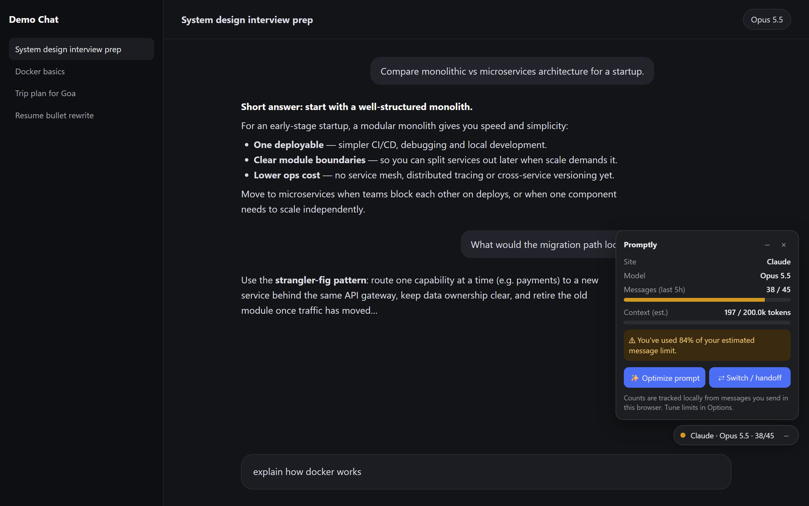
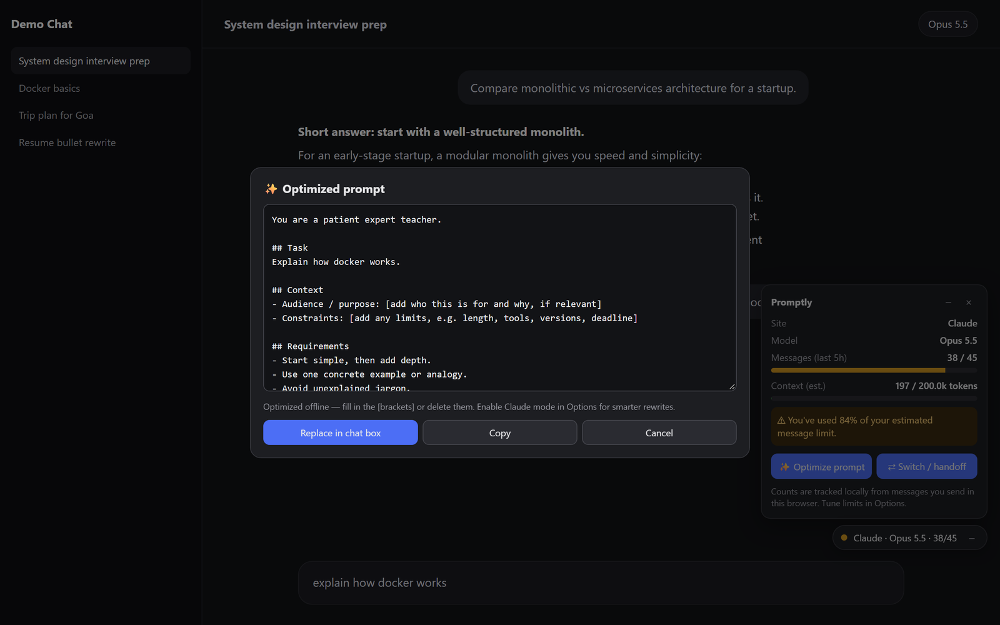
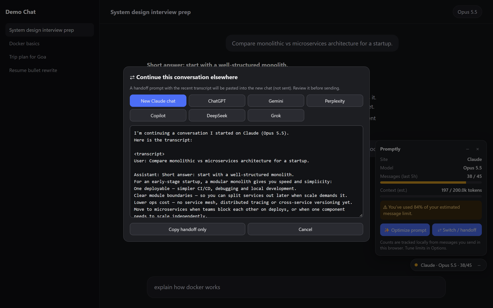
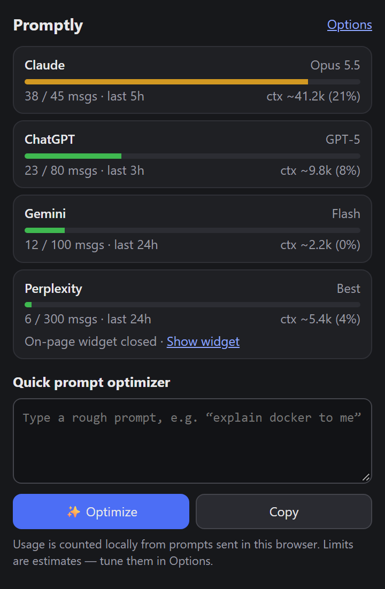
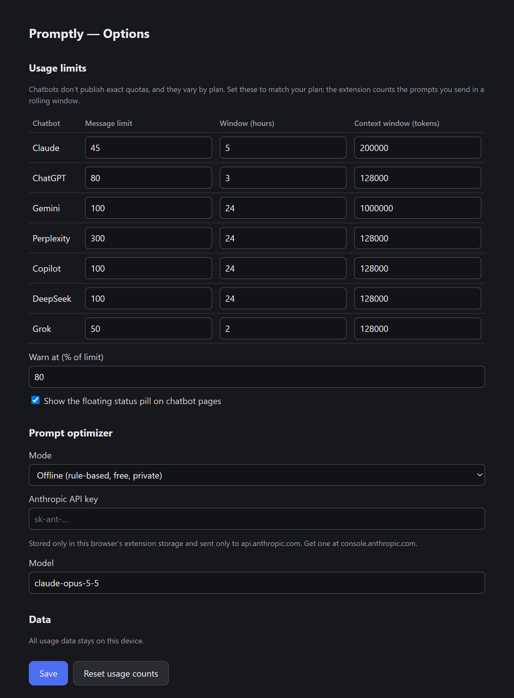
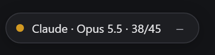
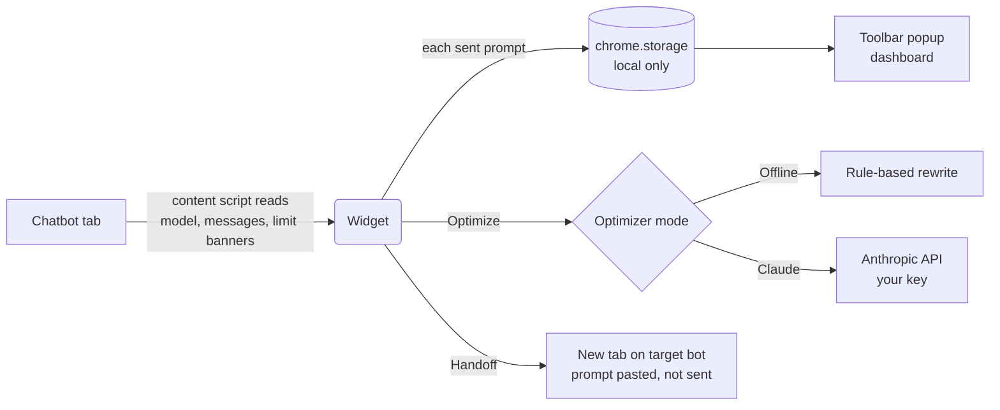

<div align="center">


# Promptly

**One small widget for every AI chatbot you use.**
See your model, usage and context at a glance. Get warned before you hit a limit. Hand off the conversation to another bot in one click, and turn rough prompts into great ones.


<br><br>



</div>

---

## ✨ Features

| | |
|---|---|
| 🧠 **Model detection** | Shows which model is selected (Opus, GPT, Flash, …), read straight from the site's model picker. |
| 📊 **Usage tracking** | Counts the prompts you send in a rolling window (e.g. `12 / 45 · last 5h`) and shows when the next slot frees up. |
| 📏 **Context meter** | Estimates how full the current conversation is compared with the model's context window. |
| ⚠️ **Limit warnings** | The widget turns amber, then red, as you approach a limit. It also picks up on-page messages like *"5 messages remaining"*. |
| ⇄ **Context switch & handoff** | Turns the recent conversation into a "continue from here" prompt and pastes it into a new chat, on the same bot or a different one. |
| ✨ **Prompt optimizer** | Rewrites a rough prompt into a structured one (role, task, context, requirements, output format). Works offline, or uses Claude with your own API key. |
| 🪶 **Stays out of your way** | Expand it, shrink it to an icon that keeps a status dot, or close it on a site. Each site remembers its own setting. |
| 🗂️ **Dashboard popup** | Every chatbot's usage on one screen, plus a quick optimizer in the toolbar. |

## 📸 See it in action

### Prompt optimizer
Type a rough prompt, press <kbd>Alt</kbd> + <kbd>Shift</kbd> + <kbd>O</kbd>, and get a structured version you can drop straight into the chat box.

<p align="center"></p>

### Context switch & handoff
Running low on messages, or the chat is getting too long? Pick another bot, or a fresh chat on the same one, and Promptly pastes a summary-ready transcript there for you.

<p align="center"></p>

### Dashboard & settings

<table>
  <tr>
    <td align="center" width="38%"><br><sub><b>Toolbar popup</b>: every chatbot at a glance</sub></td>
    <td align="center"><br><sub><b>Options</b>: limits per plan, warning threshold, optimizer mode</sub></td>
  </tr>
</table>

### Stays out of your way

<table>
  <tr>
    <td align="center"><br><sub><b>Pill</b>: site · model · usage</sub></td>
    <td align="center"><br><sub><b>Minimized</b>: just the icon with a status dot</sub></td>
    <td align="center"><sub><b>Closed</b>: hidden on that site,<br>bring it back from the popup</sub></td>
  </tr>
</table>

<sub>Screenshots show Promptly's real UI on a demo chat page with sample data.</sub>

## 🤖 Supported chatbots

<div align="center">

| Claude | ChatGPT | Gemini | Perplexity | Copilot | DeepSeek | Grok |
|:---:|:---:|:---:|:---:|:---:|:---:|:---:|
| ✅ | ✅ | ✅ | ✅ | ✅ | ✅ | ✅ |

</div>

## 🚀 Install

> Not on the Chrome Web Store yet. Load it unpacked in under a minute:

1. Clone or download this repository.
   ```bash
   git clone https://github.com/Rounakshrivastava5/Promptly.git
   ```
2. Open `chrome://extensions` (or `edge://extensions`) and turn on **Developer mode**.
3. Click **Load unpacked** and select the project folder.
4. Open any supported chatbot. The status pill appears in the bottom-right corner.

Nothing to install, build or bundle. It's plain JavaScript.

## 🕹️ Usage

| Action | How |
|---|---|
| Expand / collapse the widget | Click the status pill |
| Optimize the prompt you're typing | **✨ Optimize prompt** or <kbd>Alt</kbd> + <kbd>Shift</kbd> + <kbd>O</kbd> |
| Move the conversation to another bot or a fresh chat | **⇄ Switch / handoff** |
| Shrink to an icon | **–** on the pill or panel |
| Close on this site | **×** on the panel, or on the icon when you hover |
| Bring a closed widget back | Toolbar popup → **Show widget** |

## 🔄 How it works



## ⚙️ Configuration

Open **Options** from the popup to set:

- **Message limit, window and context size** for each chatbot. These vary by plan, so match them to yours.
- **Warning threshold**, 80% of a limit by default.
- **Optimizer mode:** *Offline* (free and private) or *Claude* (smarter rewrites using your Anthropic API key).
- Whether the floating widget appears at all.

## 🔒 Privacy

- **No servers, no analytics, no tracking.** Usage counts and settings stay in your browser's local extension storage.
- Conversation text is read **only on the page itself**, for the context estimate and handoffs.
- The only network request the extension makes is the optional Claude optimizer, which sends the prompt you're optimizing to `api.anthropic.com` with **your** API key.

## ⚠️ Good to know

- **Usage is an estimate.** No chatbot exposes your real quota, so the extension counts prompts you send from this browser. Messages sent from your phone or another browser aren't counted.
- **Context size is approximate:** about 4 characters per token, based on the messages currently shown on the page.
- **Chatbot sites change their HTML often.** If model detection or message counting stops working on one site, its selectors probably need updating (see below).

## 🛠️ Project structure

```
├── manifest.json        # MV3 manifest
├── icons/               # App icon (SVG source + PNG sizes)
├── docs/images/         # README screenshots
├── src/
│   ├── settings.js      # Defaults, storage, usage-window math
│   ├── sites.js         # Per-site selectors & limit-message patterns
│   ├── optimizer.js     # Offline optimizer + Claude system prompt
│   ├── content.js       # On-page widget, tracking, optimizer & handoff UI
│   └── background.js    # Service worker: Claude API, handoff tabs
├── popup/               # Toolbar dashboard
└── options/             # Settings page
```

## 🤝 Contributing

The most useful contribution is **keeping site support working**. Each chatbot's selectors live in [`src/sites.js`](src/sites.js):

```js
gemini: {
  composer:      ['rich-textarea .ql-editor[contenteditable="true"]'],
  sendButton:    ['button[aria-label*="Send"]'],
  model:         ['[data-test-id="bard-mode-menu-button"]'],
  userMessages:  ['user-query'],
  assistantMessages: ['model-response']
}
```

If a site breaks, inspect the page, update its selectors, reload the extension and open a PR. Adding a new chatbot works the same way: add an entry here and its URL to `manifest.json`.

## 🗺️ Roadmap ideas

- [ ] Firefox support
- [ ] Usage history charts
- [ ] Draggable widget position
- [ ] Prompt library and saved templates
- [ ] More optimizer providers

---

<div align="center">

<sub>Not affiliated with Anthropic, OpenAI, Google, Microsoft, Perplexity, DeepSeek or xAI. All product names are trademarks of their respective owners.</sub>

</div>
